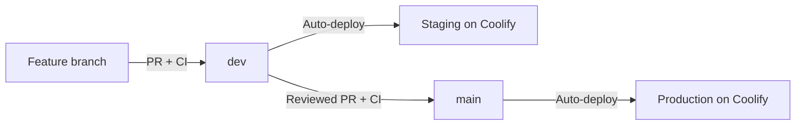

# Land Check: Deployment Plan

This is the plan for getting Land Check from GitHub to a live app on Coolify before the December 11 demo.

**This repository is public.** Do not add server IPs, dashboard URLs, tokens, open-port lists or other infrastructure details to this file. Keep them in the team's private notes.

## 1. Where we are

| Item | State |
|---|---|
| Live site | Old "under construction" page |
| Last deployment | Failed because the build could not resolve DNS while downloading Python |
| Deployable app | An interim `Dockerfile` runs CI and serves the current page. FastAPI and React are not built yet |
| Auto-deploy | On for `main`, so every push to `main` starts a deployment |
| CI | GitHub Actions passes on `dev`, including the container build. Coolify has not run it yet. The VPS agent's steps are in [`VPS_AGENT_TASK.md`](VPS_AGENT_TASK.md) |

**Do not merge to `main` until Coolify uses the Dockerfile build pack.** Under Railpack, the repo looks like a Python project with nothing serving port 3000, so a successful build could replace the working page with a broken app.

## 2. How deployment will work



The app ships as **one Docker container**. FastAPI serves the API and the built React frontend on port 3000. Coolify builds the container, and its Traefik proxy sends visitors to it.

Branch protection is what makes auto-deploy safe: code reaches `main` only through a reviewed PR with passing CI.

Lint and tests also run **inside the Docker build**, so their results appear in each Coolify deployment log. If they fail, the image is not built and that deployment stops.

## 3. Deployment steps

| Step | Task | Owner | Due |
|---|---|---|---|
| 1 | Stabilize the server and repository | Bianca, server admin | Nov 23 |
| 2 | Fix Docker DNS on the server | Ceca, server admin | Nov 24 |
| 3 | Replace the interim app stage with the API and frontend | Ceca | Nov 25 |
| 4 | Test the container locally | Ceca | Nov 25 |
| 5 | Configure Coolify | Ceca, server admin | Nov 25 |
| 6 | Create staging from `dev` | Ceca | Nov 26 |
| 7 | First production release | Bianca, Ceca | Nov 28 |
| 8 | Set up HTTPS and harden the server | Server admin | Nov 28 |
| 9 | Freeze and rehearse | Whole team | Dec 10 |

### Step 1: Stabilize

1. In Coolify, turn **Auto Deploy off** for the production app until Step 4 passes.
2. In GitHub, protect `main` and `dev` using the settings in [Section 6](#6-ci).
3. Send all new work to `dev`.

### Step 2: Fix Docker DNS

Run this on the server to test name resolution from inside a container:

```bash
docker run --rm busybox nslookup pypi.org
```

- If it **works**, retry the build. The earlier failure may have been temporary.
- If it **fails**, compare with `resolvectl status` on the host, then set working DNS servers in `/etc/docker/daemon.json`:

```json
{ "dns": ["<primary-dns>", "<secondary-dns>"] }
```

Restarting Docker briefly stops every container on the server, including Coolify. Agree on a time first, then run `sudo systemctl restart docker` and repeat the test.

### Step 3: Replace the interim app stage

The root [`Dockerfile`](../Dockerfile) has two stages:

1. **`ci`** installs the project, then runs lint and tests.
2. **`app`** currently serves the existing page and a static `/health` response on port 3000.

When the real app is ready, it needs:

- `GET /health` in FastAPI, at `landcheck.api.main:app`
- FastAPI serving `web/dist` for non-API routes
- An `api` extra in `pyproject.toml` with `fastapi` and `uvicorn`
- A `web/package-lock.json` file committed with the frontend
- The pinned dataset under `datasets/`

**Keep the `ci` stage** and replace everything after it with this target. It has not been built yet because `landcheck/api/` and `web/` do not exist:

```dockerfile
FROM node:24-slim AS web
WORKDIR /web
COPY web/package*.json ./
RUN npm ci
COPY web/ ./
RUN npm run build

FROM python:3.12-slim AS app
WORKDIR /app
COPY --from=ci /tmp/ci-passed /tmp/ci-passed
RUN apt-get update \
  && apt-get install -y --no-install-recommends curl \
  && rm -rf /var/lib/apt/lists/*
COPY pyproject.toml ./
COPY landcheck ./landcheck
COPY config ./config
COPY datasets ./datasets
RUN pip install --no-cache-dir -e ".[api]"
COPY --from=web /web/dist ./web/dist
RUN useradd --create-home app && chown -R app:app /app
USER app
ENV PORT=3000
EXPOSE 3000
HEALTHCHECK --interval=15s --timeout=3s --start-period=20s --retries=5 \
  CMD curl -fsS "http://127.0.0.1:${PORT}/health" || exit 1
CMD ["sh", "-c", "exec uvicorn landcheck.api.main:app --host 0.0.0.0 --port ${PORT}"]
```

Four details matter:

- Keep **`COPY --from=ci`**. Without it, Docker skips the CI stage and Coolify no longer runs the checks.
- Keep the **editable install** (`-e`). `core/config.py` finds `config/thresholds.yaml` relative to the source tree, so a normal install would look in the wrong folder.
- Keep **`curl` in the image** if you use a dashboard HTTP health check. Coolify runs those checks inside the container.
- Bind to **`0.0.0.0`**. A server bound to `127.0.0.1` cannot receive traffic from the proxy.

### Step 4: Test the container locally

This needs Docker and a few GB of free disk space. On Windows, run it with the Docker engine **inside WSL**.

```bash
docker build -t landcheck:local .
docker run --rm -p 3000:3000 landcheck:local
```

The build output should include `===== CI: passed =====`. If Buildx collapses the output, add `--progress=plain`. Docker without Buildx does not accept that flag. In another terminal:

```bash
curl -f http://localhost:3000/health
```

Then open <http://localhost:3000>. The interim image shows the current page. Once FastAPI and React land, also check `/api/v1/layers` and click through the demo path.

### Step 5: Configure Coolify

Set these on the production application:

| Setting | Value |
|---|---|
| Repository | `AlexFar10/LandCheck` |
| Branch | `main` |
| Build Pack | **Dockerfile** (replaces Railpack) |
| Base Directory | `/` |
| Dockerfile Location | `/Dockerfile` |
| Ports Exposes | `3000` |
| Health check | Defined by the Dockerfile |
| Auto Deploy | Off until the first manual deploy succeeds, then on |

Runtime environment variables:

| Variable | Value |
|---|---|
| `PORT` | `3000` |
| `LANDCHECK_DATASET_DIR` | `datasets/pilot-pechea/v1` |

The demo must not need EOCube, CDSE or EGMS credentials at runtime, so do not add them to Coolify. A Dockerfile `HEALTHCHECK` takes precedence over the health check set in the dashboard. If Coolify shows a Docker build target field, leave it empty so the final stage and its CI dependency both run.

### Step 6: Create staging

Create a second Coolify application with the same settings, but track **`dev`** and use a separate domain. The team can then test integrated work without touching production.

If the server does not have room for two apps, skip staging and test the container locally before each release.

### Step 7: First production release

1. Open a PR from `dev` to `main`.
2. Wait for CI and a review, then merge.
3. Click **Deploy** in Coolify and watch the build logs.
4. Confirm that the log shows `===== CI: passed =====` and `/health` responds. Once FastAPI lands, also confirm its commit and dataset version.
5. Once the map exists, click through the [demo script](PRD.md#21-demo-script).
6. Turn **Auto Deploy on**.

### Step 8: HTTPS and server hardening

**HTTPS:** set the app's domain in Coolify with an `https://` prefix, so Traefik can request a certificate. Ports 80 and 443 must be reachable. A real domain is preferred for the demo.

**Firewall:** use the hosting provider's firewall. Do not rely on UFW alone, because Docker-published ports can bypass it.

1. Put the Coolify dashboard on an HTTPS domain and confirm it works.
2. Allow public access to 80 and 443 only.
3. Restrict SSH to known addresses or a private network.
4. Close direct access to the Coolify ports listed in its [firewall guide](https://coolify.io/docs/knowledge-base/server/firewall).
5. Test the dashboard, a deployment and the app before ending the session.

Keep an existing SSH session open while changing firewall rules so that a mistake cannot lock everyone out.

### Step 9: Freeze and rehearse

By December 10:

- [ ] `main` is tagged, for example `v0.1.0-demo`
- [ ] `/health` reports the tagged commit and dataset version
- [ ] The demo works on the deployed app
- [ ] The same demo works from a local container
- [ ] A recording or screenshots are saved by at least two people
- [ ] Rollback has been tested once
- [ ] No major merges are planned

## 4. Normal release

```bash
git switch dev
git pull --ff-only
```

1. Confirm that staging or the local container works.
2. Open a PR from `dev` to `main`.
3. Get a review and a green `CI passed` check.
4. Merge. Coolify deploys automatically.
5. Check `/health` and the demo path.

## 5. Rollback

If production breaks:

1. Open the app in Coolify and go to **Rollback**.
2. Redeploy the last working image.
3. Check `/health` and the map.
4. Open a bug issue, then fix it through `dev`.

If no earlier image is available, revert the bad merge through a PR to `main`. Do not force-push `main`.

## 6. CI

The workflow is [`.github/workflows/ci.yml`](../.github/workflows/ci.yml). It runs on PRs and pushes to `dev` and `main`.

| Job | What it checks | Runs |
|---|---|---|
| Detect project parts | Whether `web/` and `Dockerfile` exist | Always |
| Main only accepts dev | PRs into `main` come from `dev` or `hotfix/*` | PRs into `main` |
| Repository safety | No real `.env` file is tracked | Always |
| Lint Python | Syntax errors and likely bugs with Ruff | Always |
| Test Python | `pytest` on Python 3.10 and 3.12 | Always |
| Build frontend | Install, lint, typecheck, test, build | When `web/package-lock.json` exists |
| Build and start container | Docker CI stage passes, image builds and `/health` responds on port 3000 | When `Dockerfile` exists |
| **CI passed** | All jobs above succeeded or were skipped | Always |

CI tests must not need network access or real credentials.

**Branch protection for `main` and `dev`:**

- Require a pull request
- Require 1 approval
- Dismiss stale approvals
- Require status check **`CI passed`**
- Require the branch to be up to date before merging
- Block force pushes and deletions

GitHub lists `CI passed` as a selectable check only after the workflow has run once.

### Seeing CI in Coolify

Coolify has no dedicated CI screen and no built-in "wait for GitHub CI" setting. Land Check runs lint and tests in the Docker build instead, so they are part of each deployment:

1. Open the application in Coolify.
2. Go to **Deployments** and open the latest one.
3. Read the log for these markers:

```text
===== CI: lint =====
===== CI: tests =====
===== CI: passed =====
```

| Result | What Coolify shows | What happens |
|---|---|---|
| Checks pass | Build continues to the app stage | New version deploys if its health check passes |
| Lint or test fails | Failed deployment with the error in the log | No new image is built, and the current version should stay live |
| Code unchanged | Docker may show the CI step as `CACHED` | The same inputs already passed. Use a forced rebuild to run it again |

GitHub remains the place for PR-only checks: source-branch rules, tracked `.env` files, Python 3.10 and frontend jobs.

**CI roadmap:**

1. Land this workflow on `dev` and fix anything the first run reports.
2. Make `CI passed` required on `dev` and `main`.
3. Add API contract tests with LC-21.
4. Add frontend checks when `web/` lands.
5. Add secret scanning, such as gitleaks, after checking the existing history.
6. After the demo, if Coolify should deploy only after GitHub CI passes, turn off Auto Deploy and trigger it with a [deploy webhook](https://coolify.io/docs/applications/sources/github/actions) from a job that depends on `CI passed`.

## 7. Troubleshooting

| Symptom | Likely cause | Fix |
|---|---|---|
| Build cannot resolve a hostname | Docker DNS | Step 2 |
| Coolify still uses Railpack | Build Pack not changed | Set it to Dockerfile |
| Bad Gateway or 503 | App not on port 3000, or bound to `127.0.0.1` | Check Ports Exposes and the `uvicorn` host |
| Deployment fails health check | `/health` failing or `curl` missing | Read container logs and run Step 4 |
| `thresholds.yaml` not found | Non-editable install | Use `pip install -e` |
| Page loads but API calls fail | Wrong API base URL | Use same-origin `/api/v1` paths |
| HTTPS fails | Domain, DNS or port 80/443 problem | Check the domain and proxy logs |
| Coolify log stops after `CI: lint` or `CI: tests` | A check failed | Read the first error above it, fix it through a PR |
| No `CI:` lines in the log | Railpack is still active, a build target is set, or the step was cached | Check the Build Pack and target, then force a rebuild |
| `network mode 'coolify' not supported by buildkit` | Reported Coolify issue with Docker 29 | See [issue #9804](https://github.com/coollabsio/coolify/issues/9804) before changing the server |

## 8. References

- [Coolify health checks](https://coolify.io/docs/applications/configuration/health-checks)
- [Coolify GitHub auto-deploy](https://coolify.io/docs/applications/sources/github/auto-deploy)
- [Coolify with GitHub Actions](https://coolify.io/docs/applications/sources/github/actions)
- [Coolify firewall](https://coolify.io/docs/knowledge-base/server/firewall)
- [Securing a Coolify server](https://coolify.io/docs/knowledge-base/how-to/secure-your-server)
