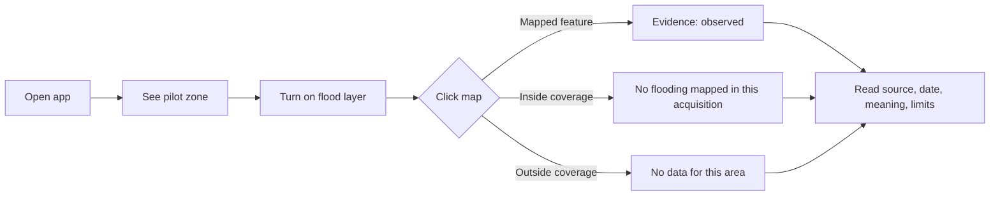
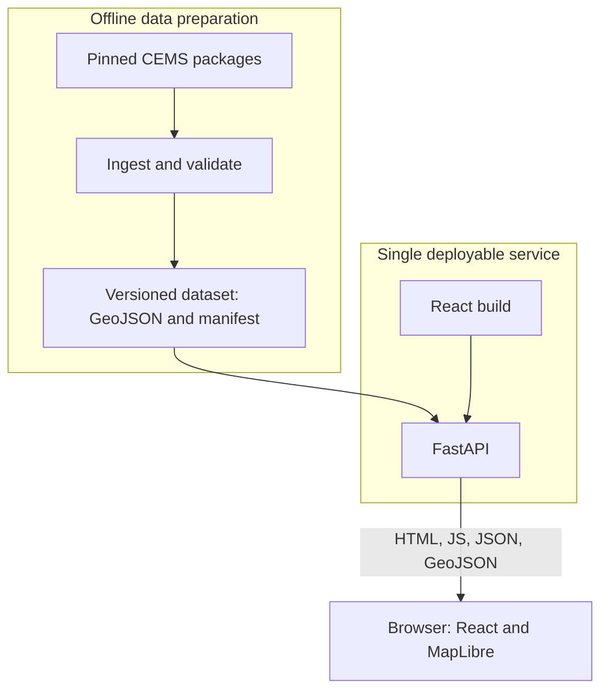
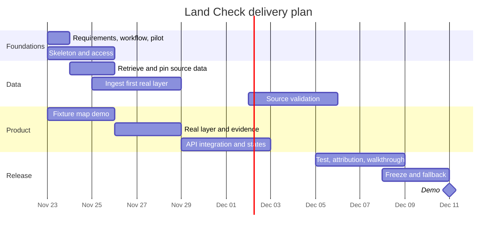
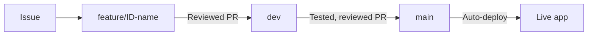

# Land Check: Product Requirements Document

| | |
|---|---|
| **Product** | Land Check, a map-first geographic hazard screening tool for insurance agencies |
| **Delivery target** | ROSPIN demonstration, December 11, 2026 |
| **Version** | 1.0 draft |
| **Date** | November 23, 2026 |
| **Requirements owner** | Raul |
| **Required reviewer** | Ceca |
| **Team** | Raul, Ceca, Bianca, Alexandra, Emilia, Stefana, Alexandru |
| **Status** | Draft for team review. Section 20 lists the decisions the team must confirm. |

This document was drafted with AI assistance from the team's addendum, the research dossier, the repository, and live checks of public data services. The team must review it before treating it as final.

**Evidence labels used in this document**

| Label | Meaning |
|---|---|
| **Verified** | Checked directly on November 23, 2026. Appendix B records how. |
| **Proposed** | A recommendation the team can change. |
| **Needs confirmation** | Unknown or unverified. Do not build on it as fact. |

## Contents

1. [Summary](#1-summary)
2. [Source documents and reconciled conflicts](#2-source-documents-and-reconciled-conflicts)
3. [Problem, users and goals](#3-problem-users-and-goals)
4. [Scope](#4-scope)
5. [Pilot zone decision](#5-pilot-zone-decision)
6. [Current state and known defects](#6-current-state-and-known-defects)
7. [Data sources and provenance](#7-data-sources-and-provenance)
8. [Scientific rules and limitations](#8-scientific-rules-and-limitations)
9. [Functional requirements](#9-functional-requirements)
10. [User experience](#10-user-experience)
11. [Technical architecture](#11-technical-architecture)
12. [API contract](#12-api-contract)
13. [Non-functional requirements](#13-non-functional-requirements)
14. [Team and ownership](#14-team-and-ownership)
15. [Milestones and integration gates](#15-milestones-and-integration-gates)
16. [Backlog](#16-backlog)
17. [Git workflow](#17-git-workflow)
18. [Test and validation plan](#18-test-and-validation-plan)
19. [Risks](#19-risks)
20. [Decisions and confirmations](#20-decisions-and-confirmations)
21. [Demo script](#21-demo-script)
22. [Definition of done](#22-definition-of-done)
- [Appendix A: References](#appendix-a-references)
- [Appendix B: Verification log](#appendix-b-verification-log)
- [Appendix C: Glossary](#appendix-c-glossary)

---

## 1. Summary

An insurance analyst often needs a quick answer before inspecting a property or reviewing a portfolio: **which documented hazards may be relevant here, and what is the evidence?** That evidence is scattered across satellite products, emergency maps and government documents.

Land Check puts it on one map. For the December 11 demo, an analyst opens the app, sees one pilot zone in Romania, turns on a real flood layer, clicks a mapped area, and reads what was observed, when, by which source, what it means and what it does not mean.

The MVP makes four product commitments:

1. **Evidence before scores.** The app shows source measurements and official categories. It does not invent a combined risk score.
2. **Unknown is not safe.** Missing data, no coverage and "nothing observed in this image" are displayed as different states. None of them is displayed as low risk.
3. **Every value is traceable.** Each displayed value links to a source, a date and a dataset version.
4. **The demo is deterministic.** Data is prepared offline, versioned and served from small REST responses. A click never starts satellite processing.

**Pilot zone:** Pechea, Galați County, using Copernicus EMS activation EMSR758 (AOI03) from the September 2024 floods. It has three public flood-extent products from September 14, 15 and 17, 2024. Raul confirmed this choice on November 23 (Section 5).

---

## 2. Source documents and reconciled conflicts

### 2.1 Source order

When sources disagree, use this order:

1. [`Land_Check_PRD_Addendum_2_Week_MVP.md`](Land_Check_PRD_Addendum_2_Week_MVP.md): the authoritative delivery constraint for scope, team, dates, workflow and stack.
2. This PRD: the addendum turned into buildable requirements.
3. [`deep-research-report.md`](deep-research-report.md): the reference for scientific method, data handling and validation, except where the addendum changes the product direction.
4. [`README.md`](../README.md) and the code: the current implementation and module contract.

The original concept document (`Idea(1).docx`) is cited by the dossier but is not in the repository. **Needs confirmation:** add it to `docs/` if the team wants it to remain a reference.

### 2.2 How conflicts were resolved

| Topic | Research dossier | Addendum | Decision in this PRD |
|---|---|---|---|
| Product | Lower Olt EO Monitor for reservoirs and vegetation | Land Check for insurance hazard screening | **Land Check** |
| Schedule | Five weeks | About two working weeks, demo December 11 | **Addendum dates** |
| Geography | Ipotești, Drăgănești, Frunzaru | One small pilot zone | **One pilot zone** (Section 5) |
| Primary hazard | Surface-water extent anomaly | Flood history and/or official flood-hazard zones | **Flood history** first |
| Ground motion | Out of scope | Conditional | **Conditional** |
| Insurance | Scoring excluded | Screening in scope, premiums and actuarial predictions excluded | **Screening only** |
| Processing | Async analysis jobs | Offline, precomputed data | **Precomputed** |
| Storage | PostGIS, Redis, S3, worker | GeoJSON first, PostGIS only if needed | **Versioned GeoJSON** |
| API | `/api/v1/analyses` and related routes | `/health`, `/api/v1/layers`, `/api/v1/zones` | **Addendum API** |
| Pages | Five pages | Minimum UI around one map | **One map workspace** |

**Carried forward from the dossier:** honest terminology, source-appropriate reflectance scaling, documented QA masks, projected-CRS area calculations, provenance on every result, frozen validation samples, spatial and temporal holdouts for any future ML, and reporting of negative results.

---

## 3. Problem, users and goals

### 3.1 Problem

Screening a location for geographic hazards currently means checking several unrelated sources. They differ in date, coverage, format and meaning. An empty map can easily be misread as "no risk," although it may only mean that nobody mapped that area.

### 3.2 Users

**Primary user: insurance analyst.** Works at an agency and screens a location or small portfolio before deciding what to inspect further. Understands insurance risk but is not a remote-sensing specialist. Needs a clear answer, a citation and the limits of that answer.

**Demo audience: ROSPIN mentors and evaluators.** They will judge whether the product is real, scientifically honest and technically coherent.

**Not a target user for the MVP:** a property owner seeking a safety certificate, an underwriter expecting an automated decision, or an engineer expecting a site survey.

### 3.3 Core job

> When I am reviewing a location, I want to see which documented hazards affect that area and the evidence behind them, so that I can decide what needs further inspection without treating a screening result as a final decision.

### 3.4 Goals

| ID | Goal | How we will know |
|---|---|---|
| G1 | Show one real hazard layer for one pilot zone | The layer renders in the correct location and matches its source |
| G2 | Make evidence readable | A first-time viewer can state the hazard, date, source and limitation from the panel |
| G3 | Never present missing data as safety | All coverage states pass the tests in Section 18 |
| G4 | Keep values traceable | Every displayed value maps to a source feature and dataset version |
| G5 | Deliver a dependable demo | Clean startup, stable `main`, tested fallback by December 10 |

The project does **not** set a model-accuracy target. No model is required, and no accuracy figure may be claimed without a documented validation.

---

## 4. Scope

### 4.1 Must have for December 11

| ID | Capability |
|---|---|
| M1 | Interactive map opened on one pilot zone |
| M2 | At least one **real** flood layer from a verified source |
| M3 | Layer toggles and a simple hazard legend |
| M4 | Clickable mapped features |
| M5 | Evidence panel with hazard type, observation date, source, coverage status, meaning and limitations |
| M6 | Distinct handling of observed, not observed, no coverage and not assessed |
| M7 | FastAPI service returning valid GeoJSON and JSON |
| M8 | UI and API that agree on every displayed value |
| M9 | Versioned, reproducible pilot dataset with source metadata |
| M10 | Loading, empty and error states |
| M11 | Attribution and limitations visible in the product |
| M12 | Reproducible startup guide, stable `main` and a tested offline fallback |

### 4.2 Conditional, only after the core path works

| ID | Capability | Condition |
|---|---|---|
| C1 | CEMS flood-depth categories | Depth unit confirmed from the source product |
| C2 | Official ANAR flood-hazard zones | Usable data and reuse terms obtained |
| C3 | Ground movement from EGMS | Measurements exist in the pilot zone and access works |
| C4 | Land-use history from Sentinel-2 or land-cover products | Reflectance defect D1 fixed and historical coverage resolved |

Conditional layers stay separate evidence layers. They do not feed a combined score.

### 4.3 Optional if time remains

Draw a parcel, summarize overlapping hazards, generate a downloadable screening report, and support additional zones.

### 4.4 Out of scope for December 11

- National coverage or automated nationwide ingestion
- Insurance premiums, pricing or underwriting decisions
- Actuarial loss predictions
- Legal buildability or zoning certification
- Real-time satellite ingestion or emergency alerting
- Complex ML without credible training data and validation, including the planned `flood_susceptibility` model
- Combined multi-hazard score
- Account management
- LLM-generated hazard conclusions

**Not blockers for the demo:** missing ML model, PDF export, automated ingestion, full multi-hazard score and polished account management.

---

## 5. Pilot zone decision

### 5.1 Decision

**Selected: Pechea, Galați County (Copernicus EMS EMSR758, AOI03).** Raul confirmed this on November 23, 2026.

| Property | Value |
|---|---|
| Event | Floods in Galați and Vaslui counties, September 2024 |
| Activation | EMSR758, activated September 14, 2024 at 13:44 |
| Pilot boundary | AOI03 polygon from the source product |
| Bounding box (W, S, E, N) | `27.6159, 45.4607, 27.8670, 45.7384` |
| Area | About 564 km² |
| Metric CRS | UTM zone 35N, `EPSG:32635` |

### 5.2 Why Pechea

| Candidate | Evidence found | Decision |
|---|---|---|
| **Pechea (EMSR758 AOI03)** | Three delivered public products from three acquisition dates, with vector flood extent | **Selected** |
| Jorăști, Cudalbi, Liești (EMSR758 AOI01, 02, 04) | Same activation, but no delivered product for these areas | Rejected |
| Covasna (May 2025) | Named as a validation case in `flood.py`, not evaluated in depth | Fallback |
| Timișoara | Used as the code's demo parcel, no flood evidence evaluated | Rejected |
| Lower Olt | Dossier's previous focus, conflicts with the addendum | Rejected |

Pechea also fits the requirement to prefer preprocessed layers that load reliably. The vector products are small (2.2 to 8.1 MB per package) and need no satellite processing.

### 5.3 What this pilot does not prove

- The layers record one flood event. They do not establish how often an area floods.
- An area without a polygon may still have flooded before, after or outside what the sensor could detect.
- The three dates use different sensors, so their area differences cannot be read as a precise recession curve.

---

## 6. Current state and known defects

### 6.1 Repository and delivery state

| Area | State on November 23 | Label |
|---|---|---|
| Repository | Public on GitHub, default branch `main` | Verified |
| Branches | `main` and `dev` exist at the same commit, neither protected | Verified |
| Project tracking | No issues, no milestones, no `.github/` templates | Verified |
| Python core | Parcel, Sentinel-2 helpers, shared result format and config exist | Verified |
| Tests | 8 of 8 pass from a clean export on Ubuntu 24.04 with Python 3.12 | Verified |
| CI | GitHub Actions passes on `dev`, including the container build. A Coolify run is pending | Verified |
| Risk modules | `flood`, `ground` and `landuse` are stubs that return `Unknown` through the pipeline | Verified |
| API | Not started | Verified |
| React frontend | Not started. The root `index.html` is the "under construction" page | Verified |
| Deployment | Auto-deploys from `main`. The latest build failed, and the deployed commit has no web server for the expected port 3000 | Reported by the team's server audit |

### 6.2 Known defects

| ID | Priority | Defect | Impact | Required action |
|---|---|---|---|---|
| D1 | **P0 for any optical layer** | `offset_for_item` in `landcheck/core/s2.py` uses the first asset that has offset metadata. On EOCube that is the aerosol band, with offset 0, while reflectance bands declare −1000 | All 16 sampled 2024 and 2025 Galați items returned 0 instead of −1000. A digital number of 1500 becomes reflectance 0.15 instead of 0.05 | Read the offset per requested band and test against real item metadata (LC-14) |
| D2 | **P0** | The committed code has no web server. An interim `Dockerfile` builds and serves the current page locally, but Coolify does not use it yet and FastAPI is not built | Deployment cannot serve the app until Coolify uses the container | LC-09 |
| D3 | P1 | Offset metadata is inconsistent across recent EOCube items. Some 2026 items have no offset fields | Fallback logic can treat items in one time series differently | Cover both cases in LC-14 and confirm with the EOCube team if needed |
| D4 | P1 | `SCL_INVALID` omits class 11 (snow/ice), which the dossier requires excluding | Snow can be treated as clear ground | Add class 11 with a test (LC-14) |
| D5 | P1 | `.gitignore` ignores `data/` and GeoTIFFs | A pilot dataset under `data/` would silently never reach Git | Store the versioned dataset under `datasets/` |
| D6 | P1 | `config/thresholds.yaml` holds unvalidated placeholders, and `ModuleResult.level` offers Low, Medium and High | Placeholder thresholds could appear as real risk classes | Do not expose `level` in the UI without a documented method |
| D7 | P1 | `landuse.start_year` is 2017, but EOCube `sentinel-2-l2a` starts on December 31, 2023 | A history back to 2017 is impossible from that collection | Resolve under C4 |
| D8 | P2 | `Unknown` currently covers no coverage, unbuilt modules and runtime errors | The UI cannot explain why a value is missing | Map these to `coverage_status` |
| D9 | P2 | Pipeline errors include raw exception text in `details` | Internal details could leak through the API | Log errors server-side and return safe messages |
| D10 | P2 | `s2.load` defaults to 10 m, including for 20 m bands | Resampling can imply detail that the band does not contain | Load SWIR-based products at 20 m |
| D11 | P2 | The README correctly says Sentinel-1 GRD is not on EOCube, but omits that the catalog has `sentinel-1-slc` and `sentinel-1-rtc`. Neither has items over Pechea for September 10 to 20, 2024 | The team may misjudge which radar data is available for the event | Update the README |
| D12 | P2 | Source flood polygons contain invalid geometries: 1 in FEP, 2 in DEL, 63 in Monitoring 1 | Spatial queries and rendering can fail | Repair during ingest and record the area change (LC-15) |

---

## 7. Data sources and provenance

### 7.1 Source inventory

| Source | MVP role | Availability for Pechea | Terms | Status |
|---|---|---|---|---|
| **Copernicus EMS EMSR758 AOI03** | **Primary must-have layer** | Three public packages downloaded and read | Cite per the CEMS guidelines. Commercial reuse not confirmed | Verified availability, **terms need confirmation** |
| ANAR flood hazard maps | Conditional official layer | Cycle II plans are public PDFs. No machine-readable source found | Unknown | Needs confirmation |
| EOCube `sentinel-2-l2a` | Optional visual context | 12 items in September 2024. Collection starts December 31, 2023 | Sentinel open data, EOCube platform terms unconfirmed | Verified availability |
| EOCube `sentinel-1-rtc`, `sentinel-1-slc` | Not used for the event | No items for September 10 to 20, 2024 | n/a | Verified gap |
| EOCube `jrc-gsw-v1-5-occurrence` | Possible permanent-water context | Covers the zone | Catalog says "proprietary" | Terms need confirmation |
| EOCube `copernicus-dem-30` | Possible terrain context | Covers the zone | Catalog says "proprietary" | Terms need confirmation |
| EOCube `esa-worldcover-2021` | Possible land-cover context | No items returned for the zone | CC-BY-4.0 | Do not rely on it |
| EGMS Ortho | Conditional ground movement | Not checked for the zone. Rural areas may have sparse measurements | Copernicus policy | Needs confirmation |
| CORINE, CLMS Water and Wetness | Possible context | Not checked | CLMS attribution required | Needs confirmation |
| UVT land suitability and soil layers on EOCube | **Do not use** | Not checked | CC-BY-NC-ND-4.0 | Non-commercial, no derivatives |

The UVT restriction matters because Land Check targets insurance agencies. Do not include those layers without written permission.

### 7.2 Pilot layers

All three products are public. Acquisition times are as published by CEMS.

| Layer ID | Product | Acquired | Sensor | Flood polygons | Area in EPSG:32635 | Source `area` total |
|---|---|---|---|---:|---:|---:|
| `flood_emsr758_aoi03_fep_v1` | First Estimate | 2024-09-14 04:22 | Sentinel-1 | 108 | 1,078.6 ha | 1,079.4 ha |
| `flood_emsr758_aoi03_del_v1` | Delineation | 2024-09-15 15:59 | PAZ | 131 | 866.7 ha | 867.3 ha |
| `flood_emsr758_aoi03_monit01_v1` | Delineation Monitoring 1 | 2024-09-17 16:13 | COSMO-SkyMed Second Generation | 237 | 427.4 ha | 427.7 ha |

**Recommended default layer:** `flood_emsr758_aoi03_del_v1`. It is a full delineation and is the first product after the First Estimate.

The Delineation products also contain flood-depth categories (`Below 0.50`, `0.50 - 1.00`, `1.00 - 2.00`, `2.00 - 4.00`). The vector metadata does not state the unit, so depth is conditional (C1) until the unit is confirmed from the product map.

**Unresolved value:** the CEMS activation summary reports a maximum extent of 918.4 ha, which does not match any of the three package totals. Its event extent of 427.4 ha matches Monitoring 1. Do not display the 918.4 ha figure unless the team can explain it.

### 7.3 Source package pins

| Package | Bytes | SHA-256 |
|---|---:|---|
| `EMSR758_AOI03_FEP_PRODUCT_v1.zip` | 2,222,132 | `95e81d5839d3fd8b24ebb68651bc7f3b349168ac04847204a8e3dadc36df133b` |
| `EMSR758_AOI03_DEL_PRODUCT_v1.zip` | 5,301,056 | `8cb85940a59291147b11dbe9dfd5be75c37d37e1c061c1832a531cb543d7642e` |
| `EMSR758_AOI03_DEL_MONIT01_v1.zip` | 8,088,771 | `c5f662293b7cfb977504bf84335c25218e65b4786e78baed4bd1444a3b6e1eb5` |

Download pattern:

```text
https://rapidmapping.emergency.copernicus.eu/backend/EMSR758/AOI03/FEP_PRODUCT/EMSR758_AOI03_FEP_PRODUCT_v1.zip
https://rapidmapping.emergency.copernicus.eu/backend/EMSR758/AOI03/DEL_PRODUCT/EMSR758_AOI03_DEL_PRODUCT_v1.zip
https://rapidmapping.emergency.copernicus.eu/backend/EMSR758/AOI03/DEL_MONIT01/EMSR758_AOI03_DEL_MONIT01_v1.zip
```

### 7.4 Dataset package

Processed data lives in Git, subject to the license confirmation in D-03. Raw ZIP files stay out of Git and are pinned by checksum.

```text
datasets/
└── pilot-pechea/
    └── v1/
        ├── manifest.json
        ├── coverage.geojson
        └── layers/
            ├── flood_emsr758_aoi03_fep_v1.geojson
            ├── flood_emsr758_aoi03_del_v1.geojson
            └── flood_emsr758_aoi03_monit01_v1.geojson
```

Published dataset versions are immutable. Any data change creates a new version directory.

**Manifest shape:**

```json
{
  "dataset_id": "pilot-pechea",
  "dataset_version": "v1",
  "created_at": "<UTC timestamp>",
  "code_commit": "<git sha>",
  "method_version": "cems-ingest-0.1",
  "pilot_crs_metric": "EPSG:32635",
  "layers": [
    {
      "layer_id": "flood_emsr758_aoi03_del_v1",
      "hazard_type": "flood_history",
      "observation_date": "2024-09-15",
      "acquired_at_as_published": "2024-09-15T15:59:00",
      "sensor": "PAZ",
      "source_name": "Copernicus EMS Rapid Mapping EMSR758",
      "source_url": "https://mapping.emergency.copernicus.eu/activations/EMSR758",
      "source_package": "EMSR758_AOI03_DEL_PRODUCT_v1.zip",
      "source_package_sha256": "8cb85940a59291147b11dbe9dfd5be75c37d37e1c061c1832a531cb543d7642e",
      "source_layer": "observedEventA",
      "feature_count": 131,
      "invalid_geometries_repaired": 2,
      "area_ha_before_repair": 866.7,
      "area_ha_after_repair": "<computed>",
      "output_sha256": "<computed>"
    }
  ]
}
```

### 7.5 Ingest rules

The ingest command must:

1. Download or read each pinned package and **fail if its checksum differs**.
2. Read `observedEventA`, `areaOfInterestA` and `imageFootprintA`.
3. Repair invalid geometries, and record the count and area change.
4. Calculate polygon area in `EPSG:32635`.
5. Build each layer's coverage from the intersection of the AOI and image footprint.
6. Assign deterministic feature IDs from the layer ID and canonical geometry.
7. Write RFC 7946 GeoJSON in WGS84 with `(longitude, latitude)` order.
8. Write `manifest.json` with checksums.

Running ingest twice on the same inputs must produce byte-identical layer files.

---

## 8. Scientific rules and limitations

### 8.1 Rules for all hazard data

1. **No data is `Unknown`, never `Low`.** An empty result is not evidence of safety.
2. **Risk classes need a documented method.** Show Low, Moderate or High only when a cited classification supports them. Otherwise show the measurement or official category.
3. **No artificial combined score.** Each hazard stands as separate evidence.
4. **No invented values.** Do not invent availability, precision, accuracy, legal suitability or EOCube capabilities.
5. **Illustrative numbers never appear as results.** Examples in documents and fixtures must be clearly labelled.
6. **Keep the source's language.** Display official categories verbatim.
7. **Report limitations and negative results.**

### 8.2 Coverage semantics

| `coverage_status` | Meaning | Allowed wording | Forbidden wording |
|---|---|---|---|
| `observed` | A source feature exists here | "Flooding observed on {date}" | "High risk" unless a documented method applies |
| `not_observed` | Inside the source's coverage, with no mapped feature | "No flooding mapped in this acquisition" | "Safe," "low risk," "never flooded" |
| `no_coverage` | Outside the source's coverage | "No data for this area" | "No hazard" |
| `not_assessed` | Layer unavailable, unbuilt or failed | "Not assessed" | Any implied result |

### 8.3 Interpreting CEMS flood polygons

- A polygon is the flood extent derived from **one image at one time**.
- Radar can miss water under dense vegetation and around buildings, and it can confuse other smooth surfaces with water.
- Peak flooding may have occurred between acquisitions.
- A one-event layer does not provide a return period or probability.
- CEMS Rapid Mapping supports emergency response. It is not a property-level survey.

**Required product disclaimer:**

> This is a hazard screening result. It is not an engineering survey, legal determination or underwriting decision.

### 8.4 Satellite processing rules for conditional layers

- **Coordinates:** store WGS84 as `(lon, lat)` and measure in the feature's UTM zone. Romania spans zones 34 and 35, so never hard-code one zone in shared code.
- **Reflectance:** apply source-specific scaling and offsets per band and per item.
- **Masking:** before computing indices, reject Sentinel-2 SCL classes 0, 1, 3, 8, 9, 10 and 11. Record whether class 7 is also excluded.
- **Resolution:** resampling does not add information. Calculate SWIR-based products at 20 m.
- **Index names:** never expose a generic `ndwi`. Use `ndwi_water_mcfeeters` or `ndwi_vegetation_gao`.
- **Reads:** fail loudly. No silent nodata fills and no forward-filling.
- **Thresholds:** keep them in `config/thresholds.yaml` and version them.
- **Any future ML:** hold out whole basins, regions or years. Never split pixels randomly.

---

## 9. Functional requirements

Priorities: **P0** is required for the demo, **P1** is expected, **P2** is conditional or optional.

### 9.1 Map and layers

| ID | Requirement | Priority |
|---|---|---|
| FR-01 | The app opens centered on the pilot zone with its coverage boundary visible | P0 |
| FR-02 | The layer list comes from `GET /api/v1/layers`, not hard-coded UI data | P0 |
| FR-03 | The user can toggle each layer on and off | P0 |
| FR-04 | The legend reflects the visible layers and uses source categories | P0 |
| FR-05 | The default layer loads automatically | P1 |
| FR-06 | Layer dates are visible so the three acquisitions cannot be confused | P0 |

### 9.2 Selection and evidence

| ID | Requirement | Priority |
|---|---|---|
| FR-07 | Clicking a feature selects and highlights it | P0 |
| FR-08 | The evidence panel loads details from `GET /api/v1/zones/{id}` | P0 |
| FR-09 | The panel shows hazard type, observation date, source link, coverage status, method version, meaning and limitations | P0 |
| FR-10 | Clicking inside coverage with no feature shows `not_observed` wording | P0 |
| FR-11 | Clicking outside coverage shows `no_coverage` wording | P0 |
| FR-12 | Null classification or measurement displays "Not available" and never `0` | P0 |
| FR-13 | The user can clear the selection | P1 |

### 9.3 Data and API

| ID | Requirement | Priority |
|---|---|---|
| FR-14 | The API serves the pinned dataset version | P0 |
| FR-15 | `GET /api/v1/zones?bbox=...` returns valid GeoJSON and coverage information | P0 |
| FR-16 | Invalid requests return the standard error object | P0 |
| FR-17 | `GET /health` reports service status and dataset version | P0 |
| FR-18 | Every feature contains all minimal API fields | P0 |

### 9.4 Reliability and trust

| ID | Requirement | Priority |
|---|---|---|
| FR-19 | Loading, empty and error states are implemented | P0 |
| FR-20 | Source attribution remains visible on the map | P0 |
| FR-21 | The screening disclaimer is visible without opening a menu | P0 |
| FR-22 | A short methodology view explains the source, dates and limits | P1 |
| FR-23 | A prerecorded or screenshot fallback is available | P0 |

### 9.5 Conditional and optional

| ID | Requirement | Scope |
|---|---|---|
| FR-30 | CEMS flood-depth category layer | C1 |
| FR-31 | Official ANAR hazard-zone layer | C2 |
| FR-32 | EGMS ground-movement layer | C3 |
| FR-33 | Land-use history layer | C4 |
| FR-40 | Draw a parcel | Optional |
| FR-41 | Summarize hazards overlapping a parcel | Optional |
| FR-42 | Download a screening report | Optional |
| FR-43 | Add another zone | Optional |

---

## 10. User experience

### 10.1 Primary flow



### 10.2 Minimum screens

**Screen 1: Map workspace (desktop first)**

```text
┌────────────────────────────────────────────────────────────────────┐
│ Land Check       Pilot: Pechea, Galați           Screening only ⓘ  │
├───────────────┬───────────────────────────────┬────────────────────┤
│ LAYERS        │                               │ EVIDENCE           │
│ ☑ Sep 15 2024 │                               │ Flood history      │
│   Delineation │                               │ Observed           │
│ ☐ Sep 14 2024 │          INTERACTIVE          │                    │
│   First est.  │              MAP              │ Observed on        │
│ ☐ Sep 17 2024 │                               │ Sep 15, 2024       │
│   Monitoring  │     coverage boundary and     │                    │
│               │     clickable flood polygons  │ Source             │
│ LEGEND        │                               │ Copernicus EMS ↗   │
│ ■ Flood       │                               │                    │
│ ▨ No coverage │                               │ What this means    │
│               │                               │ What it does not   │
├───────────────┴───────────────────────────────┴────────────────────┤
│ Attribution · Screening result, not a survey or underwriting decision │
└────────────────────────────────────────────────────────────────────┘
```

**Screen 2: Evidence panel states** are observed, not observed, no coverage, not assessed, loading and error.

**Screen 3: Methodology view** is a modal or drawer with the data source, dates, processing steps, limitations and citations.

### 10.3 Required states

| State | Trigger | Message |
|---|---|---|
| Initial | No selection | "Select a mapped area to see its evidence." |
| Loading | Request pending | "Loading evidence..." |
| Observed | Feature selected | "Flooding observed on {date}." |
| Not observed | Click in coverage | "No flooding mapped in this acquisition. This does not mean the area is safe." |
| No coverage | Click outside coverage | "No data for this area. This does not mean the area is safe." |
| Not assessed | Layer unavailable | "This layer has not been assessed here." |
| API error | Request fails | "Evidence could not be loaded. Try again." |

### 10.4 Design and accessibility

- Prioritize a functional desktop map over visual polish.
- Never rely on color alone. Pair color with labels, patterns or outlines.
- Do not use green for `not_observed` or `no_coverage`, because it implies safety.
- Controls must work with a keyboard and have visible focus.
- Text and legend colors must meet WCAG AA contrast.

---

## 11. Technical architecture

### 11.1 Overview



### 11.2 Stack

| Layer | Technology | Status |
|---|---|---|
| Backend | Python, FastAPI | Agreed |
| Frontend | TypeScript, React | Agreed |
| Build tool | Vite | Proposed |
| Map | MapLibre GL JS | Proposed by addendum |
| Design | Figma | Agreed |
| Satellite platform | EOCube | Agreed, capabilities being verified |
| Storage | Versioned GeoJSON, PostGIS only if needed | Agreed |
| Deployment | Coolify with a root Dockerfile | Proposed |

### 11.3 Proposed repository layout

```text
LandCheck/
├── AGENTS.md
├── CLAUDE.md
├── CODEX.md
├── Dockerfile                 # interim: runs CI, serves current page
├── config/thresholds.yaml
├── datasets/pilot-pechea/v1/  # proposed
├── docs/
├── landcheck/
│   ├── api/                   # proposed FastAPI app
│   ├── core/
│   ├── ingest/                # proposed offline data commands
│   ├── modules/
│   └── pipeline.py
├── tests/
└── web/                       # proposed React app
```

### 11.4 Deployment

**Current flow:** a push to `main` triggers a Coolify build, and Coolify routes traffic to a container on port 3000. **Every merge to `main` is therefore a production release.**

**Proposed target:**

- A multi-stage root `Dockerfile` builds `web/`, installs the Python app and copies the pinned dataset.
- FastAPI serves the API and the built frontend from one origin, which avoids CORS in production.
- The server binds `0.0.0.0:${PORT:-3000}`.
- Coolify uses `GET /health` as its health check.
- The current page stays live until the replacement passes a local container test.

The step-by-step plan is in [DEPLOYMENT.md](DEPLOYMENT.md). Setup for contributors is in [GETTING_STARTED.md](GETTING_STARTED.md).

### 11.5 Configuration

| Variable | Purpose | Default |
|---|---|---|
| `PORT` | HTTP port | `3000` |
| `LANDCHECK_DATASET_DIR` | Dataset path | `datasets/pilot-pechea/v1` |
| `LANDCHECK_CORS_ORIGINS` | Allowed dev origins | Empty in production |
| `EOCUBE_*`, `CDSE_*`, `EGMS_*` | Offline data access only | Unset |

Runtime demo paths must not require upstream credentials.

---

## 12. API contract

All responses are JSON or GeoJSON. Coordinates are WGS84 in `(longitude, latitude)` order.

### 12.1 Endpoints

| Method | Path | Purpose |
|---|---|---|
| `GET` | `/health` | Service and dataset status |
| `GET` | `/api/v1/layers` | Available layers and metadata |
| `GET` | `/api/v1/zones?bbox=W,S,E,N[&layer=ID]` | Features in a bounding box |
| `GET` | `/api/v1/zones/{id}` | One feature with full evidence |

### 12.2 Minimal zone object

| Field | Type | Nullable | Notes |
|---|---|---|---|
| `id` | string | No | Stable feature ID, at GeoJSON Feature level |
| `geometry` | GeoJSON geometry | No | At GeoJSON Feature level |
| `hazard_type` | string | No | `flood_history`, `flood_hazard_zone`, `ground_stability`, `land_use` |
| `classification` | string | **Yes** | Source category only |
| `measurement` | number | **Yes** | Source or derived value |
| `unit` | string | **Yes** | Required when `measurement` exists |
| `observation_date` | ISO date | No | Date of the observation or map |
| `source_name` | string | No | Human-readable source |
| `source_url` | URL | No | Source page |
| `coverage_status` | enum | No | Section 8.2 |
| `method_version` | string | No | Processing version |

Additional properties: `layer_id` and `dataset_version`.

### 12.3 `GET /health`

```json
{
  "status": "ok",
  "version": "0.1.0",
  "git_commit": "<sha>",
  "dataset_id": "pilot-pechea",
  "dataset_version": "v1"
}
```

### 12.4 `GET /api/v1/layers`

```json
{
  "layers": [
    {
      "id": "flood_emsr758_aoi03_del_v1",
      "title": "Flood extent, Sep 15, 2024",
      "hazard_type": "flood_history",
      "default_visible": true,
      "observation_date": "2024-09-15",
      "sensor": "PAZ",
      "source_name": "Copernicus EMS Rapid Mapping EMSR758",
      "source_url": "https://mapping.emergency.copernicus.eu/activations/EMSR758",
      "attribution": "<confirmed citation text>",
      "meaning": "Area mapped as flooded in this satellite acquisition.",
      "limitations": [
        "Shows one acquisition time, not the full flood peak.",
        "Absence of a polygon does not mean the area is safe."
      ],
      "legend": [
        { "label": "Observed flood extent", "color": "#2563EB" }
      ],
      "feature_count": 131,
      "coverage": { "type": "MultiPolygon", "coordinates": [] },
      "method_version": "cems-ingest-0.1",
      "dataset_version": "v1"
    }
  ]
}
```

### 12.5 `GET /api/v1/zones`

The response is an RFC 7946 FeatureCollection with a `coverage` foreign member.

The geometry and measurement below are **illustrative only** and must not appear as demo results.

```json
{
  "type": "FeatureCollection",
  "coverage": [
    { "layer_id": "flood_emsr758_aoi03_del_v1", "status": "partial" }
  ],
  "features": [
    {
      "type": "Feature",
      "id": "flood_emsr758_aoi03_del_v1-3fa94c21b07d",
      "geometry": {
        "type": "Polygon",
        "coordinates": [[
          [27.7400, 45.6000],
          [27.7420, 45.6000],
          [27.7420, 45.6015],
          [27.7400, 45.6000]
        ]]
      },
      "properties": {
        "layer_id": "flood_emsr758_aoi03_del_v1",
        "hazard_type": "flood_history",
        "classification": null,
        "measurement": 1.23,
        "unit": "ha",
        "observation_date": "2024-09-15",
        "source_name": "Copernicus EMS Rapid Mapping EMSR758",
        "source_url": "https://mapping.emergency.copernicus.eu/activations/EMSR758",
        "coverage_status": "observed",
        "method_version": "cems-ingest-0.1",
        "dataset_version": "v1"
      }
    }
  ]
}
```

**Coverage status values for a query:** `full`, `partial` or `none`.

A bbox outside the pilot returns `200` with an empty feature list and `"status": "none"`. The UI must display this as no coverage, never as a safe area.

### 12.6 `GET /api/v1/zones/{id}`

Returns one GeoJSON Feature with the same properties, plus `meaning`, `limitations` and `attribution` from its layer.

### 12.7 Errors

```json
{
  "error": {
    "code": "INVALID_BBOX",
    "message": "bbox must be west,south,east,north in WGS84.",
    "details": { "bbox": "abc" }
  }
}
```

| HTTP | Code | When |
|---|---|---|
| 400 | `INVALID_BBOX` | Wrong format, order or range |
| 404 | `LAYER_NOT_FOUND` | Unknown layer ID |
| 404 | `ZONE_NOT_FOUND` | Unknown zone ID |
| 500 | `INTERNAL_ERROR` | Unexpected error, with no internal details exposed |
| 503 | `DATASET_UNAVAILABLE` | Dataset missing or checksum failure |

---

## 13. Non-functional requirements

| Area | Requirement |
|---|---|
| Performance | Proposed target: `/api/v1/layers` and pilot `/api/v1/zones` respond in under 1 second on the demo server. Measure before December 8 |
| Determinism | The same dataset version always returns the same values |
| Availability | The demo runs without live EOCube, CDSE or CEMS access |
| Security | No secrets in Git or the frontend bundle. Public-repo content contains no server addresses or infrastructure details |
| Input safety | Validate all parameters. Accept no user-supplied file paths or URLs |
| Privacy | The core app requires no personal data |
| Accessibility | Keyboard-usable controls, visible focus, and no meaning conveyed by color alone |
| Attribution | Required source credits remain visible |
| Observability | Structured logs with request path, status and duration, without secrets |
| Portability | Developers can run the project on Linux or WSL using the startup guide |
| Extensibility | New regions are added as new dataset packages, without API changes |

---

## 14. Team and ownership

### 14.1 Workstreams

| Workstream | Owner | Deliverable | Reviewer |
|---|---|---|---|
| Requirements and issues | **Raul** | MVP scope, stories, acceptance criteria, milestones, priorities, pilot decision | Ceca |
| Environment and skeleton | **Ceca** | `AGENTS.md`, `CLAUDE.md`, FastAPI, React, run guide, Docker if feasible, `/health`, sample response | Bianca |
| Repository workflow | **Bianca** | Branches, `main` and `dev` protection, PR template, issue conventions, merge support | Ceca or an available teammate |
| Clickable demo | **Alexandra + Emilia** | Figma wireframe, React map, selectable layer, clickable zone, evidence panel | Each other |
| Satellite data and integration | **Stefana + Alexandru** | EOCube project and access, one real dataset, backend exposure, source agreement | Each other |

### 14.2 Integration ownership

- **UI-to-API connection:** Alexandra and Emilia
- **Geospatial correctness:** Stefana and Alexandru
- **Backend contract and developer environment:** Ceca
- **CI:** Raul, reviewed by Bianca
- **Scope changes:** Raul, with team agreement

Nobody waits for one central person to approve every change.

### 14.3 Unassigned code ownership

The code still has blank owners for `core/`, `flood.py`, `ground.py` and `landuse.py`. See decision D-06.

---

## 15. Milestones and integration gates

November 23 and 25 are the agreed milestones. Later dates are proposed integration gates and may move without weakening the December 10 freeze.

| Date | Milestone | Acceptance gate |
|---|---|---|
| **Nov 23** | M0 Foundations | Requirements and prioritized issues ready, pilot selected, workflow and environment documented, `AGENTS.md` in place |
| **Nov 25** | M1 Skeleton | FastAPI and React run, EOCube access verified, clickable fixture demo, first dataset retrieved or blocker documented |
| **Nov 28** | M2 First real layer | One real georeferenced layer displays, zone click shows source and date |
| **Dec 2** | M3 Real API | Frontend uses real API, legend, states and `unknown/no coverage` behavior complete |
| **Dec 5** | M4 End-to-end | Full demo path works, spatial data validated against source samples |
| **Dec 8** | M5 Demo-ready | Testing, attribution, limitations and walkthrough complete |
| **Dec 10** | M6 Release freeze | `main` stable, dataset cached, deployment and fallback tested |
| **Dec 11** | Demo | ROSPIN demonstration, no major feature merges |



---

## 16. Backlog

Each story below is sized to become one GitHub issue and one branch. Where a pair owns a story, the partner who does not write the PR reviews it.

### M0: Foundations (Nov 23)

#### LC-01 Confirm the pilot zone
**Owner:** Raul · **Reviewer:** Ceca · **Priority:** P0

As the team, we want one confirmed pilot zone so that all work targets the same area.

- [x] Raul confirmed Pechea on November 23
- [x] Decision D-01 is updated in this PRD
- [ ] The decision is shared with the whole team

#### LC-02 Create milestones and issues
**Owner:** Raul · **Reviewer:** Ceca · **Priority:** P0 · **Depends on:** LC-01

As a contributor, I want prioritized issues so that I know what to work on next.

- [ ] GitHub milestones M0 to M6 exist with due dates
- [ ] Each must-have story exists as an issue with acceptance criteria, owner and reviewer
- [ ] Priority labels exist

#### LC-03 Protect `main` and `dev`
**Owner:** Bianca · **Reviewer:** Ceca · **Priority:** P0

As the team, we want protected branches so that production cannot change without review.

- [ ] Direct pushes to `main` and `dev` are blocked
- [ ] PRs need at least one approval, and self-approval cannot satisfy this
- [ ] A test PR confirms the rules work

#### LC-04 Add PR and issue templates
**Owner:** Bianca · **Reviewer:** Raul · **Priority:** P0

As a reviewer, I want consistent PRs so that I can review them quickly.

- [ ] PR template includes issue reference, tests, UI screenshots and reviewer
- [ ] Issue templates cover user stories and bugs
- [ ] Branch naming is documented

#### LC-05 Review agent instructions
**Owner:** Ceca · **Reviewer:** Bianca · **Priority:** P0

As a contributor using a coding agent, I want one shared instruction file so that agents follow team rules.

- [ ] `AGENTS.md` is reviewed against this PRD
- [ ] `CLAUDE.md` and `CODEX.md` point to `AGENTS.md`
- [ ] Setup commands work for a second teammate

### M1: Skeleton (Nov 25)

#### LC-06 Create the FastAPI skeleton
**Owner:** Ceca · **Reviewer:** Bianca · **Priority:** P0

As a frontend developer, I want a running API so that I can integrate early.

- [ ] `GET /health` returns the Section 12.3 shape
- [ ] `GET /api/v1/layers` returns a labelled fixture
- [ ] OpenAPI docs load locally
- [ ] An automated test covers `/health`

#### LC-07 Create the React and MapLibre skeleton
**Owner:** Ceca · **Reviewer:** Alexandra or Emilia · **Priority:** P0

As a map developer, I want a running frontend so that I can build the demo.

- [ ] TypeScript React app runs locally
- [ ] MapLibre displays a basemap centered on the pilot
- [ ] Basemap attribution is visible

#### LC-08 Document local setup
**Owner:** Ceca · **Reviewer:** Bianca · **Priority:** P0 · **Depends on:** LC-06, LC-07

As a new contributor, I want one startup guide so that I can run the project quickly.

- [ ] [`GETTING_STARTED.md`](GETTING_STARTED.md) covers backend, frontend and tests on Linux or WSL
- [ ] A teammate follows it from a clean clone without help

#### LC-09 Repair the deployment path
**Owner:** Ceca · **Reviewer:** Bianca · **Priority:** P0 · **Depends on:** LC-06

As the team, we want a working deployment so that the demo does not depend on one laptop.

- [ ] The container builds and serves `/health` locally on port 3000
- [ ] The previous DNS build failure is diagnosed
- [ ] Coolify deploys the container and its health check passes
- [ ] The current site is not replaced until the local container test passes

#### LC-10 Set up EOCube and verify team access
**Owner:** Stefana or Alexandru · **Reviewer:** the other · **Priority:** P0

As the data pair, we want confirmed access so that blockers surface early.

- [ ] One person creates the EOCube project and invites all seven members
- [ ] The other confirms each member's access
- [ ] Supported exports, APIs and processing permissions are documented
- [ ] Commercial-use terms are checked or recorded as open

#### LC-11 Create the Figma wireframe
**Owner:** Alexandra or Emilia · **Reviewer:** the other · **Priority:** P0

As the team, we want one agreed layout so that implementation does not drift.

- [ ] One desktop layout covers map, layers, legend and evidence panel
- [ ] All Section 10.3 states are represented

#### LC-12 Build the clickable fixture demo
**Owner:** Alexandra or Emilia · **Reviewer:** the other · **Priority:** P0 · **Depends on:** LC-07

As an analyst, I want to click a zone so that I can see how evidence is presented.

- [ ] One fixture layer can be toggled
- [ ] Clicking a zone opens the evidence panel
- [ ] The fixture is visibly marked as sample data

#### LC-13 Retrieve and pin the pilot source data
**Owner:** Stefana or Alexandru · **Reviewer:** the other · **Priority:** P0 · **Depends on:** LC-01

As the data pair, we want pinned inputs so that the dataset is reproducible.

- [ ] Source packages are retrieved and match Section 7.3 checksums, or a blocker is documented
- [ ] CEMS citation text and reuse terms are recorded
- [ ] Raw files remain outside Git

#### LC-29 Activate continuous integration
**Owner:** Raul · **Reviewer:** Bianca · **Priority:** P0

As the team, we want automatic checks on every PR so that broken code cannot reach the live app.

- [ ] `.github/workflows/ci.yml` runs on a PR into `dev`
- [x] Python lint and tests pass on the first real run, or failures are fixed
- [ ] `CI passed` is a required check on `dev` and `main`
- [ ] A PR into `main` from a feature branch is rejected
- [ ] The frontend job activates when `web/` is added
- [ ] Lint and test results appear in a Coolify deployment log
- [ ] A failing test stops the Coolify deployment and leaves the current version live

### M2: First real layer (Nov 28)

#### LC-14 Fix Sentinel-2 radiometry defects
**Owner:** Stefana or Alexandru · **Reviewer:** the other, plus the `core/` owner · **Priority:** P0 before any optical layer

As a data user, I want correct reflectance so that optical layers are not biased.

- [ ] The offset is read for each requested band
- [ ] Tests use real metadata shapes, including a non-zero band offset with a zero-offset aerosol asset
- [ ] Items without offset metadata are handled explicitly
- [ ] SCL class 11 is excluded and tested

#### LC-15 Ingest the CEMS layers
**Owner:** Stefana or Alexandru · **Reviewer:** the other · **Priority:** P0 · **Depends on:** LC-13

As a developer, I want a versioned dataset so that the app serves traceable data.

- [ ] One command creates `datasets/pilot-pechea/v1`
- [ ] It follows every rule in Section 7.5
- [ ] A second run produces identical layer checksums
- [ ] Feature counts match Section 7.2
- [ ] Geometry repair counts and area changes are recorded

#### LC-16 Serve real layers and zones
**Owner:** Stefana or Alexandru · **Reviewer:** the other, with Ceca on the contract · **Priority:** P0 · **Depends on:** LC-06, LC-15

As the frontend, I want real API data so that the map shows source values.

- [ ] `/api/v1/layers` and both zone endpoints meet Section 12
- [ ] A bbox outside the pilot returns an empty list with `none` coverage
- [ ] Unknown IDs and invalid bboxes return the standard error

#### LC-17 Display the first real layer
**Owner:** Alexandra or Emilia · **Reviewer:** the other · **Priority:** P0 · **Depends on:** LC-12, LC-16

As an analyst, I want to see real flood polygons so that I can inspect the event.

- [ ] Polygons render in the correct location
- [ ] Clicking a polygon shows its real source and date

### M3: Real API and states (Dec 2)

#### LC-18 Replace all fixture reads
**Owner:** Alexandra or Emilia · **Reviewer:** the other · **Priority:** P0 · **Depends on:** LC-16

As an analyst, I want the UI to show API values so that the screen matches the evidence.

- [ ] Layers and zones come only from the API
- [ ] A test or manual check confirms panel values equal API values

#### LC-19 Add layer controls and legend
**Owner:** Alexandra or Emilia · **Reviewer:** the other · **Priority:** P0 · **Depends on:** LC-18

As an analyst, I want to compare dates so that I do not confuse acquisitions.

- [ ] All pilot layers can be toggled
- [ ] Each control shows its date and product type
- [ ] The legend updates with visible layers and does not rely on color alone

#### LC-20 Implement all evidence and coverage states
**Owner:** Alexandra or Emilia · **Reviewer:** the other, plus Raul for wording · **Priority:** P0 · **Depends on:** LC-18

As an analyst, I want clear states so that missing data is never mistaken for safety.

- [ ] All Section 10.3 states work
- [ ] Clicking inside and outside coverage produces different messages
- [ ] No state uses the words "safe" or "low risk" as a result

#### LC-21 Add API contract tests
**Owner:** Ceca · **Reviewer:** Stefana or Alexandru · **Priority:** P1 · **Depends on:** LC-16

As a developer, I want contract tests so that changes cannot silently break the UI.

- [ ] Tests validate required fields, GeoJSON structure, errors and coverage behavior

### M4: End-to-end (Dec 5)

#### LC-22 Validate data against source samples
**Owner:** Stefana + Alexandru · **Reviewer:** Raul · **Priority:** P0 · **Depends on:** LC-15

As an evaluator, I want evidence that displayed data matches the source.

- [ ] Section 18.3 checks pass and results are saved in `docs/`
- [ ] Mismatches are fixed or documented

#### LC-23 Test the full demo path
**Owner:** Alexandra + Emilia · **Reviewer:** Ceca · **Priority:** P0 · **Depends on:** LC-19, LC-20

As the team, we want the core path proven before polish.

- [ ] A teammate completes the Section 21 path on the deployed or local app
- [ ] Bugs are filed as issues

#### LC-24 Decide on a second layer
**Owner:** Raul · **Reviewer:** Stefana or Alexandru · **Priority:** P2 · **Depends on:** LC-23

As the team, we want to add evidence only when it is reliable.

- [ ] The team approves or rejects C1 to C4 using documented evidence
- [ ] Any approved layer has its own issue and meets Section 22

### M5: Demo-ready (Dec 8)

#### LC-25 Finish attribution, limitations and methodology
**Owner:** Raul · **Reviewer:** Stefana or Alexandru · **Priority:** P0

As an analyst, I want to understand the source and limits of the data.

- [ ] Confirmed attribution appears in the product
- [ ] Methodology covers source, dates, processing and limitations
- [ ] Copy follows Section 8

#### LC-26 Prepare the demo walkthrough
**Owner:** Raul · **Reviewer:** Ceca · **Priority:** P0 · **Depends on:** LC-23

As a presenter, I want a rehearsed script so that the demo fits its time slot.

- [ ] The script is timed and rehearsed by two people
- [ ] Every number spoken comes from the running app or this PRD's verified data

### M6: Release freeze (Dec 10)

#### LC-27 Freeze and release `main`
**Owner:** Bianca · **Reviewer:** Ceca · **Priority:** P0 · **Depends on:** LC-22, LC-23, LC-25

As the team, we want a stable release so that the demo is predictable.

- [ ] `dev` is promoted to `main` through a reviewed PR
- [ ] The deployed version reports the expected commit and dataset version
- [ ] A release tag is created
- [ ] No major merges follow without team agreement

#### LC-28 Create and test the fallback demo
**Owner:** Alexandra + Emilia · **Reviewer:** Raul · **Priority:** P0 · **Depends on:** LC-23

As a presenter, I want a fallback so that a network outage does not end the demo.

- [ ] A recording or screenshot sequence covers the full script
- [ ] A local run is tested with the network disabled, or its limits are documented
- [ ] At least two people have the fallback files

---

## 17. Git workflow

1. Write every feature and bug as a GitHub issue.
2. Create one branch per issue from the latest `dev`, for example `feature/24-risk-map` or `fix/31-empty-state`.
3. Keep PRs small enough to review within a day.
4. Open the PR into `dev` using the template: issue reference, tests, UI screenshots and reviewer.
5. **One person writes, another reviews.** No self-approval.
6. Rebase on the latest `dev` before merging.
7. Promote tested, demo-ready work from `dev` to `main` through a reviewed PR.
8. Avoid merging untested data changes immediately before the demo.
9. Require the `CI passed` check before any merge into `dev` or `main`.



**Review pairs:** Ceca reviews Raul's requirements. Alexandra and Emilia review each other. Stefana and Alexandru review each other. Bianca and available teammates cross-review infrastructure and workflow PRs.

---

## 18. Test and validation plan

### 18.1 Automated tests

| Level | Coverage |
|---|---|
| Core | UTM selection, parcel handling, offsets, masks, `no_coverage` |
| Ingest | Checksum failure, geometry repair, stable IDs, deterministic output |
| API | Required fields, bbox validation, errors, coverage states |
| Frontend | Null values, evidence states, layer toggles |
| End-to-end | Open map, enable layer, click feature, read evidence |

### 18.2 Mandatory safety cases

- [ ] `no_coverage` never appears as low risk or safe
- [ ] Null classification is not rendered as `0`
- [ ] An empty API result inside the pilot does not imply safety
- [ ] A bbox outside the pilot returns coverage `none`
- [ ] A failed layer is shown as not assessed

### 18.3 Spatial data validation

Run these before the December 5 gate:

1. Package checksums match Section 7.3.
2. Feature counts match Section 7.2.
3. Area totals are recomputed in `EPSG:32635`. A change above **0.1%** caused by geometry repair blocks release until explained. This is a proposed data-integrity check, not a scientific accuracy claim.
4. All output geometries are valid and inside WGS84 bounds.
5. A random sample of at least 10 features per layer, selected with a recorded seed, is compared with the original product.
6. At least 3 features per layer are visually compared with the CEMS map or viewer.
7. API values match the dataset and the UI for the same sample.

Store the sample IDs and results in `docs/validation/`.

### 18.4 Manual release checks

- Fresh clone starts by following the guide
- Keyboard can operate layer controls and panel
- Attribution and disclaimer remain visible
- No secrets appear in Git or the frontend bundle
- Fallback demo opens on the presentation machine

---

## 19. Risks

| Risk | Likelihood | Impact | Mitigation | Owner |
|---|---|---|---|---|
| Empty area is read as safe | Medium | High | Coverage states, tests and copy review | Alexandra + Emilia |
| CEMS reuse terms restrict the use case | Medium | High | Confirm by Nov 25, keep demo non-commercial if needed | Raul |
| EOCube access or capability differs from assumptions | Medium | Medium | CEMS layer does not depend on EOCube | Stefana + Alexandru |
| Sentinel-2 offset defect reaches an optical layer | High if unfixed | High | LC-14 blocks optical work | Stefana + Alexandru |
| Deployment remains broken | Medium | High | Fix by M1, keep a local and recorded fallback | Ceca |
| Unreviewed merge deploys to production | Medium | High | Protect `main` on Nov 23 | Bianca |
| Scope grows beyond one layer | High | High | Second layer only through LC-24 | Raul |
| Integration happens too late | Medium | High | Fixtures on Nov 25, real API by Dec 2 | Ceca |
| Network outage on demo day | Medium | High | Cached data and tested fallback | Alexandra + Emilia |
| Secret or infrastructure detail is published | Low | High | Public-repo rules, PR review | Everyone |
| Multiple dates are misread as a precise trend | Medium | Medium | Label dates and sensors, add limitations | Raul |

---

## 20. Decisions and confirmations

| ID | Decision or confirmation | Recommendation | Owner | Due | Status |
|---|---|---|---|---|---|
| D-01 | Pilot zone | Pechea, EMSR758 AOI03 | Raul | Nov 23 | **Decided** |
| D-02 | Default layer | Delineation, Sep 15, 2024 | Stefana + Alexandru | Nov 25 | Open |
| D-03 | CEMS citation and reuse in a commercial-facing demo, and committing derived GeoJSON | Confirm from the CEMS terms | Raul | Nov 25 | Open |
| D-04 | EOCube commercial-use terms and supported processing | Ask the EOCube team | Stefana or Alexandru | Nov 25 | Open |
| D-05 | Deployment approach | Single Dockerfile on Coolify | Ceca | Nov 25 | Open |
| D-06 | Owners for `core/`, `flood.py`, `ground.py`, `landuse.py` | Data pair owns `core/` and flood | Team | Nov 25 | Open |
| D-07 | CEMS depth unit | Read it from the product map before using C1 | Stefana or Alexandru | Dec 2 | Open |
| D-08 | CEMS 918.4 ha summary discrepancy | Do not display it unless explained | Stefana or Alexandru | Dec 5 | Open |
| D-09 | ANAR hazard map access | Request it, do not block the MVP | Raul | Nov 28 | Open |
| D-10 | EGMS coverage in the pilot | Check before committing to C3 | Stefana or Alexandru | Dec 2 | Open |
| D-11 | Cadastre access for parcel input | Keep out of the MVP | Raul | After demo | Open |
| D-12 | Final basemap provider | Open basemap with visible attribution | Alexandra + Emilia | Nov 25 | Open |

---

## 21. Demo script

**Target length:** about 5 minutes. Read all values from the running app.

| Time | Action | Talking point |
|---|---|---|
| 0:00 | Show the app on the pilot zone | "An insurance analyst needs to know which documented hazards may matter here before going further." |
| 0:30 | Point to Pechea and the coverage boundary | "We started with one zone where public evidence exists: the September 2024 Galați floods." |
| 1:00 | Turn on the September 15 flood layer | "This is a real Copernicus Emergency Management Service product, not a generated risk map." |
| 1:40 | Click a flood polygon | "The analyst sees the hazard, date, source, method version and limitations." |
| 2:30 | Open the source link | "Every value can be traced to its source." |
| 3:00 | Click inside coverage, away from a polygon | "No flood was mapped in this image. That does **not** mean the location is safe." |
| 3:30 | Click outside coverage | "Here we have no data, so the product says exactly that." |
| 4:00 | Toggle September 14 and 17 | "Each layer is a separate observation from a different satellite, so we show them separately." |
| 4:30 | Show the disclaimer and close | "Land Check speeds up screening and shows its evidence. It does not replace an inspection or an underwriting decision." |

**Fallback order:** deployed app, then local app with cached data, then recording or screenshots.

---

## 22. Definition of done

### 22.1 Any issue

- [ ] Acceptance criteria are met
- [ ] Relevant tests pass
- [ ] A different team member approved the PR
- [ ] UI changes include screenshots
- [ ] Documentation is updated if behavior changed

### 22.2 Any data layer

- [ ] Source, date, version and license are recorded
- [ ] Checksums and method version exist
- [ ] Coverage is defined
- [ ] Values were checked against the source
- [ ] Meaning and limitations are written for an analyst
- [ ] Missing data displays as unknown or no coverage

### 22.3 December 11 MVP

The MVP is successful when an insurance analyst can open the deployed or locally demoed React app, identify the pilot zone, turn on at least one **real** hazard layer, click a mapped feature, and see a readable explanation with source, date, meaning and limitations.

The following must also be true:

- FastAPI and the UI agree on returned values
- Empty or unsupported areas are never called safe
- A reproducible startup guide exists
- `main` is stable
- A prerecorded or screenshot fallback is ready for a network outage

---

## Appendix A: References

Time-sensitive access rules and quotas should be rechecked before use.

**Project documents**

- [PRD addendum](Land_Check_PRD_Addendum_2_Week_MVP.md)
- [Research dossier](deep-research-report.md)
- [Getting started](GETTING_STARTED.md)
- [Deployment and CI plan](DEPLOYMENT.md)

**Pilot data**

- [Copernicus EMS EMSR758 activation](https://mapping.emergency.copernicus.eu/activations/EMSR758)
- [EMSR758 event notice](https://mapping.emergency.copernicus.eu/news/flood-in-galati-and-vaslui-counties-romania/)
- [Copernicus EMS citation guidelines](https://mapping.emergency.copernicus.eu/about/citation-guidelines/)
- [Copernicus EMS terms and conditions](https://mapping.emergency.copernicus.eu/terms-and-conditions/)

**Satellite and geospatial platforms**

- [EOCube documentation](https://docs.eocube.ro/en/)
- [EOCube STAC API](https://stac.eocube.ro)
- [CDSE STAC documentation](https://documentation.dataspace.copernicus.eu/APIs/STAC.html)
- [CDSE quotas](https://documentation.dataspace.copernicus.eu/Quotas.html)
- [Sentinel-2 L2A documentation](https://documentation.dataspace.copernicus.eu/APIs/SentinelHub/Data/S2L2A.html)
- [Sentinel data terms](https://dataspace.copernicus.eu/terms-and-conditions)

**Conditional hazard data**

- [EGMS Ortho](https://land.copernicus.eu/en/products/european-ground-motion-service/egms-ortho)
- [EGMS 2020 to 2024 update](https://land.copernicus.eu/en/news/european-ground-motion-service-releases-latest-product-update)
- [CLMS data policy](https://land.copernicus.eu/en/data-policy)
- [Prut-Bârlad flood risk management plan, cycle II](https://mmediu.ro/app/webroot/uploads/files/PMRI_ciclul%20II_%20ABA%20Prut%20Barlad.pdf)
- [Siret flood risk management plan, cycle II](https://mmediu.ro/app/webroot/uploads/files/PMRI_ciclul%20II_%20ABA%20Siret_.pdf)

**Implementation**

- [FastAPI](https://fastapi.tiangolo.com/)
- [MapLibre GL JS](https://maplibre.org/maplibre-gl-js/docs/)
- [RFC 7946: GeoJSON](https://www.rfc-editor.org/rfc/rfc7946)
- [pystac-client](https://pystac-client.readthedocs.io/)

---

## Appendix B: Verification log

All checks ran on November 23, 2026.

| Check | Method | Result |
|---|---|---|
| Repository settings | GitHub public API and `git ls-remote` | Public, `main` and `dev`, no protection, issues, milestones or `.github/` |
| Test suite | Clean export of `HEAD`, Ubuntu 24.04 in WSL, Python 3.12, `pip install -e ".[dev]"` | 8 passed |
| Pipeline | `python -m landcheck.pipeline` | All four risks return `Unknown` |
| Container | Real `docker build` and run on the WSL Docker engine | Lint and 8 tests passed in the build, container healthy, `/health` and current page served as non-root |
| CI failure handling | Added a failing test and a lint error in a disposable container | Both stopped the CI stage |
| EOCube catalog | Paginated `/collections` | 25 collections |
| Sentinel-2 start date | Collection temporal extent | `sentinel-2-l2a` starts 2023-12-31 |
| Offset defect | Ran `offset_for_item` on live Galați items and compared with B03 metadata | 2024 and 2025: 16 of 16 returned 0 where B03 declares −1000 |
| Offset metadata variation | Inspected 2026 items | Some lack offset fields, and the November 22, 2026 item includes them |
| EMSR758 products | CEMS public activation record | Only AOI03 has delivered products |
| Product contents | Downloaded and read all three AOI03 packages | Counts, dates, sensors, areas and checksums in Section 7 |
| Geometry validity | GeoPandas validity check on `observedEventA` | Invalid: FEP 1, DEL 2, Monitoring 1 63 |
| EOCube pilot coverage | STAC search with the AOI03 polygon | S2 L2A 12 items for Sep 2024, S1 none for Sep 10 to 20, 2024, JRC and DEM present, WorldCover 2021 none |

**Not verified:**

- CEMS commercial reuse terms and the exact required attribution for this use
- EOCube commercial-use terms and processing limits
- The CEMS flood-depth unit
- EGMS measurements inside the pilot zone
- A machine-readable ANAR hazard-map source
- The current server state, which comes from the team's audit and was not rechecked for this document

---

## Appendix C: Glossary

| Term | Meaning |
|---|---|
| **AOI** | Area of interest, the boundary of a mapped or analyzed area |
| **ANAR** | Administrația Națională Apele Române, Romania's national water administration |
| **CEMS** | Copernicus Emergency Management Service |
| **CDSE** | Copernicus Data Space Ecosystem |
| **COG** | Cloud-Optimized GeoTIFF |
| **CRS** | Coordinate reference system |
| **DEL** | CEMS Delineation product, which maps the affected area |
| **DN** | Digital number, a raw stored pixel value before scaling |
| **EGMS** | European Ground Motion Service |
| **EOCube** | Romanian Earth-observation data platform used by the project |
| **FEP** | CEMS First Estimate Product, a rapid early estimate |
| **GeoJSON** | JSON format for geographic features |
| **L2A** | Sentinel-2 surface-reflectance product level |
| **MapLibre** | Open-source browser map renderer |
| **NDWI** | Normalized Difference Water Index. Two different formulas share this name, so always specify which |
| **SAR** | Synthetic aperture radar, which can image through cloud |
| **SCL** | Sentinel-2 Scene Classification Layer, used for cloud and quality masking |
| **STAC** | SpatioTemporal Asset Catalog, a standard for searching geospatial data |
| **UTM** | Universal Transverse Mercator, a metric map projection divided into zones |
